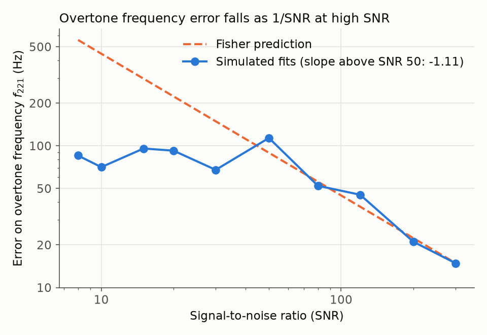
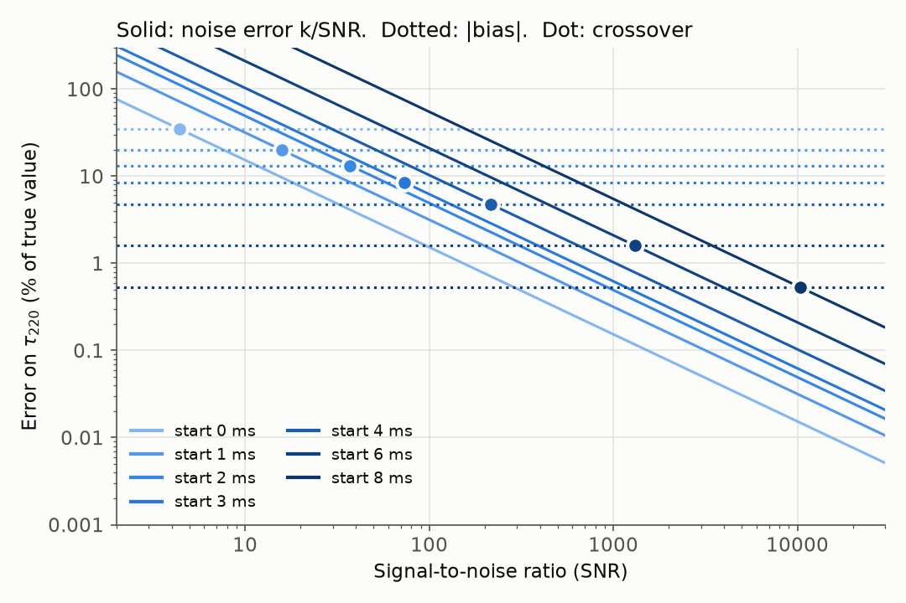

# Ringdown Lab

A small simulation study of black-hole "ringdown" for my TKS Focus Project.

## Question

At what signal-to-noise ratio (SNR) does the **bias** from a slightly wrong model
(ignoring the 221 overtone) become larger than the **error caused by noise**, when
measuring a ringing black hole?

## Hypothesis

Noise error shrinks like 1/SNR as the signal gets louder, but the bias from using the
wrong model does not depend on SNR at all. So for every choice of fit start time there
should be a **crossover SNR** above which the bias wins. Starting the fit later lets the
overtone die away, so the bias gets smaller and the crossover should move to higher SNR.

## Method

1. **Physics.** Frequencies and damping times of the 220 and 221 modes come from the
   Berti, Cardoso & Will (2006) fits:
   `F = f1 + f2(1-χ)^f3`, `Q = q1 + q2(1-χ)^q3`, `f = F / (2πM)`, `τ = Q / (πf)`,
   for a GW250114-like remnant (M = 62.7 M☉, χ = 0.68).
   This gives 220: 271.41 Hz, 3.759 ms, and 221: 265.41 Hz, 1.238 ms.
2. **Signal.** Sum of two damped sinusoids, sampled at 4096 Hz for 0.1 s, starting at
   the peak. Both modes have amplitude 1 and phase 0.
3. **Noise.** White Gaussian noise with σ = 1. The signal is scaled so that its optimal SNR,
   `sqrt(Σh²)/σ`, equals the target.
4. **Experiment A (two-mode fit).** At SNR 8–300, fit both modes to N = 200 noisy copies
   (`scipy.optimize.curve_fit`, f in 100–500 Hz, τ in 0.1–20 ms). The fit starts within
   ±10% of the true f and τ. Error = half of the 16th–84th percentile range of the fitted
   f221. "Overtone lost" = the fit failed or f221 is more than 20% off. Compare with the
   Fisher-matrix prediction and fit the log-log slope for SNR ≥ 50.
5. **Experiment B (one-mode fit).** The data contain both modes, but we fit only the
   fundamental, starting 0–8 ms after the peak. **Bias** = noiseless fit of τ220 minus the
   true value. **Noise error** = spread of τ220 over N noisy fits. Fitting noise error ≈ k/SNR
   (k taken from SNR ≥ 50) gives the **crossover SNR = k / |bias|**.

The SNR is always the SNR of the *whole* signal from the peak. When the fit starts later,
less of the signal is left, so the noise error at the same SNR is bigger.

### Why white noise is acceptable here

Real LIGO noise is "coloured": it is very large at low frequencies (seismic motion) and
grows again at high frequencies (laser shot noise). In between is a "bucket" where the
detector is most sensitive and the noise is roughly flat. Both modes here sit near
265–271 Hz, close to that bucket. Over the narrow band the signal mostly occupies, the
real noise is close to constant, and constant-in-frequency noise is exactly white noise.
The overtone is short-lived, so its power is spread over a wider band, which makes this
approximation weaker for the 221 mode than for the 220 mode.

## How to run

```bash
pip install -r requirements.txt
pip install -e .              # lets Python find the ringdown_lab package from anywhere
python -m pytest              # 13 checks of the physics, signal, noise and fits
python run_build.py           # full run, N = 200 (about 2 minutes)
python run_build.py --quick   # N = 30, for a fast try
python run_build.py --figures-only   # redraw figures from results/results.json
```

Then open `notebooks/01_build.ipynb`.

## Results (N = 200, seed 2026)

**Experiment A: measuring the overtone with a two-mode fit**

| SNR | f221 error (Hz) | Fisher (Hz) | overtone lost |
|----:|----------------:|------------:|--------------:|
| 8   | 85.3  | 558.1 | 40.5% |
| 10  | 70.7  | 446.4 | 34.0% |
| 15  | 95.7  | 297.6 | 36.5% |
| 20  | 92.4  | 223.2 | 36.0% |
| 30  | 67.7  | 148.8 | 36.5% |
| 50  | 113.6 | 89.3  | 47.0% |
| 80  | 52.2  | 55.8  | 32.0% |
| 120 | 45.2  | 37.2  | 25.0% |
| 200 | 21.0  | 22.3  | 5.0%  |
| 300 | 14.9  | 14.9  | 0.0%  |

Log-log slope of the error for SNR ≥ 50: **−1.11** (expected ≈ −1).

**Experiment B: bias from ignoring the overtone (one-mode fit of τ220)**

| fit start (ms) | bias on τ220 | crossover SNR |
|---------------:|-------------:|--------------:|
| 0 | −34.70% | 4.4 |
| 1 | −19.89% | 15.9 |
| 2 | −13.27% | 37.2 |
| 3 | −8.47%  | 73.5 |
| 4 | −4.77%  | 216.1 |
| 6 | −1.60%  | 1311.0 |
| 8 | −0.53%  | 10420.9 |

Figures are in `figures/`, all numbers in `results/results.json`.




## Assumptions and limitations

- **White noise.** Real detector noise is coloured and not perfectly Gaussian (see above).
- **Amplitude ratio 1, phase 0.** Both modes start with the same amplitude and no phase
  offset. Real overtone amplitudes and phases depend on the merger, and the bias depends
  strongly on them.
- **Free-frequency fits.** f and τ of each mode are fitted freely, not tied to one mass and
  spin as in General Relativity. This is a harder fit than a real "mass and spin" analysis.
- **Single detector.** Real events are seen by several detectors with different noise and
  antenna patterns.
- **Least-squares fits, not Bayesian sampling.** At low SNR (below about 50) the overtone
  is barely constrained, so the fitter often stays close to its ±10% starting guess. The
  measured spread there is then smaller than the Fisher prediction. It reflects the
  starting guess and the f bounds (100–500 Hz) more than the noise. Only the high-SNR
  points show the real 1/SNR behaviour.
- **Bounds cap the noise error.** τ is limited to 0.1–20 ms, so at low SNR and late start
  times the τ220 spread hits that limit (about 240% in figure 4) and is not a true error.
- **Fixed start time 0 = peak.** The two-mode model is assumed to be exact from the peak.

## License

MIT © 2026 Leonardo Perugia
