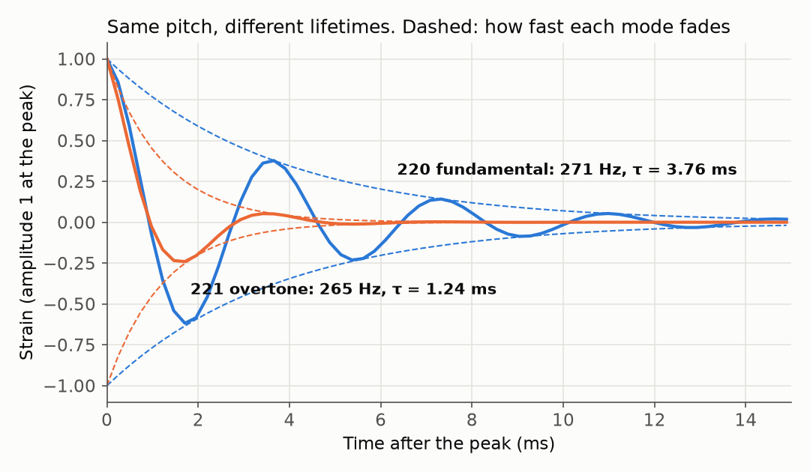
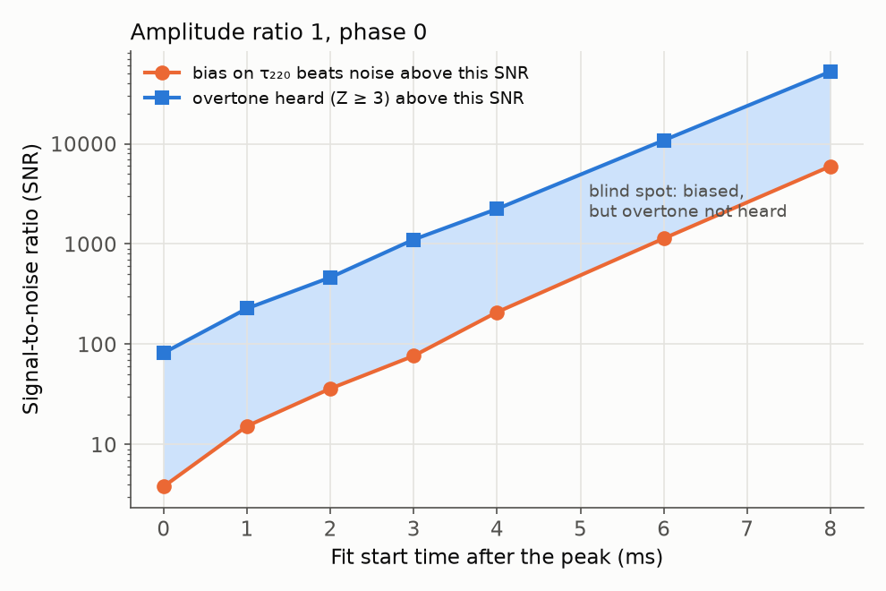
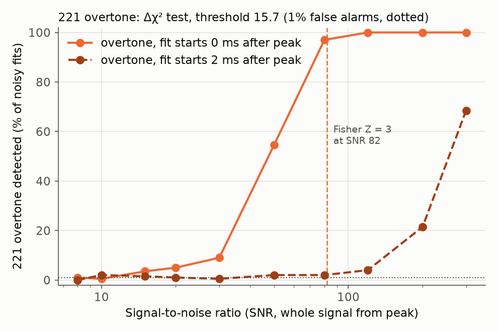
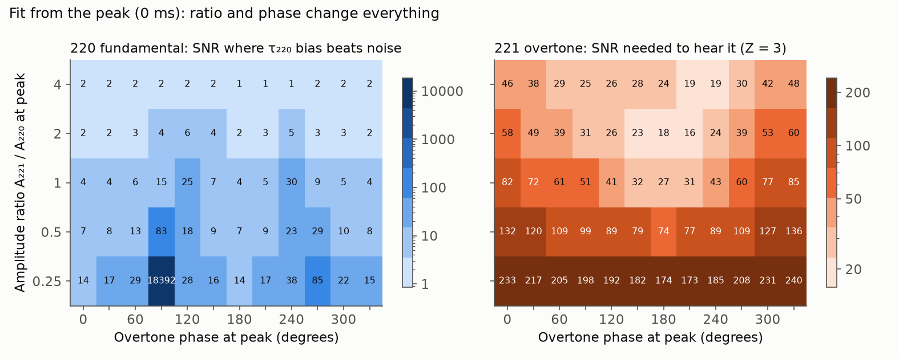

# Ringdown Lab

A simulation study of black-hole "ringdown" for my TKS Focus Project, with an
interactive app: **[Overtone Explorer](app/index.html)**. Open it in any browser,
move the sliders, and it tells you whether the overtone can be heard, and why.

## Question

At what signal-to-noise ratio (SNR) does the **bias** from a slightly wrong model
(ignoring the 221 overtone) become larger than the **error caused by noise**, when
measuring a ringing black hole?

Follow-up question (Part 2): at that point, **can you even hear the overtone?**

## Hypothesis

Noise error shrinks like 1/SNR as the signal gets louder, but the bias from using the
wrong model does not depend on SNR at all. So for every choice of fit start time there
should be a **crossover SNR** above which the bias wins. Starting the fit later lets the
overtone die away, so the bias gets smaller and the crossover should move to higher SNR.

## Method

1. **Physics.** Frequencies and damping times of the 220 and 221 modes come from the
   Berti, Cardoso & Will (2006) fits:
   `F = f1 + f2(1-χ)^f3`, `Q = q1 + q2(1-χ)^q3`, `f = F / (2πM)`, `τ = Q / (πf)`,
   for a GW250114-like remnant (M = 62.7 M☉, χ = 0.68).
   This gives 220: 271.41 Hz, 3.759 ms, and 221: 265.41 Hz, 1.238 ms.
2. **Signal.** Sum of two damped sinusoids, sampled at 4096 Hz for 0.1 s, starting at
   the peak. Both modes have amplitude 1 and phase 0.
3. **Noise.** White Gaussian noise with σ = 1. The signal is scaled so that its optimal SNR,
   `sqrt(Σh²)/σ`, equals the target.
4. **Experiment A (two-mode fit).** At SNR 8–300, fit both modes to N = 200 noisy copies
   (`scipy.optimize.curve_fit`, f in 100–500 Hz, τ in 0.1–20 ms). The fit starts within
   ±10% of the true f and τ. Error = half of the 16th–84th percentile range of the fitted
   f221. "Overtone lost" = the fit failed or f221 is more than 20% off. Compare with the
   Fisher-matrix prediction and fit the log-log slope for SNR ≥ 50.
5. **Experiment B (one-mode fit).** The data contain both modes, but we fit only the
   fundamental, starting 0–8 ms after the peak. **Bias** = noiseless fit of τ220 minus the
   true value. **Noise error** = spread of τ220 over N noisy fits. Fitting noise error ≈ k/SNR
   (k taken from SNR ≥ 50) gives the **crossover SNR = k / |bias|**.
6. **Experiment C (can you hear it?).** Fit one mode and two modes to the same noisy data.
   The improvement Δχ² = χ²(one mode) − χ²(two modes) is big when an overtone is really
   there. To know what "big" means, the same fits are run on data with **no** overtone: the
   99th percentile of Δχ² there (15.70) is the threshold, so noise alone fools the test only
   1% of the time. This is compared with the Fisher-matrix **significance Z** of the overtone
   amplitude, where Z ≥ 3 counts as heard (the "3σ" bar used for real events).
7. **Experiment D (amplitude and phase).** On a grid of overtone amplitude ratio
   (0.25–4) and phase (0–330°), compute the crossover SNR and the SNR needed for Z = 3.

The SNR is the SNR of the *whole* signal from the peak, unless stated otherwise. When the
fit starts later, less of the signal is left.

### Why white noise is acceptable here

Real LIGO noise is "coloured": it is very large at low frequencies (seismic motion) and
grows again at high frequencies (laser shot noise). In between is a "bucket" where mirror
coating thermal noise dominates and the noise is nearly flat. On the O4 design curves the
noise amplitude changes by only about 14% between 150 and 500 Hz. Both modes here sit near
265–271 Hz. Over the band the fundamental occupies (about 80 Hz wide), the real noise is
practically constant, and constant-in-frequency noise is exactly white noise. The overtone
is short-lived, so its spectrum is about 250–300 Hz wide and reaches the steep noise wall
below 50 Hz. White noise is therefore a weaker approximation for the overtone, and it makes
the overtone look a little easier to hear than in real data. Sources and numbers:
[docs/overtone_detectability_research.md](docs/overtone_detectability_research.md).

## How to run

```bash
pip install -r requirements.txt
pip install -e .              # lets Python find the ringdown_lab package from anywhere
python -m pytest              # 30 checks: physics, signal, noise, fits, detection, app
python run_build.py           # Experiments A and B, N = 200 (about 2 minutes)
python run_detect.py          # Experiments C and D, N = 200 (about 6 minutes)
python run_build.py --quick   # N = 30, for a fast try (also works for run_detect.py)
python run_build.py --figures-only   # redraw figures from results/*.json
```

Then open `notebooks/01_build.ipynb`, and `app/index.html` in a browser.

## Results (N = 200, seeds 2026 and 2027)

**Colour code in every figure and in the app: blue = 220 fundamental, orange = 221 overtone.**



### Experiment A: measuring the overtone with a two-mode fit

| SNR | f221 error (Hz) | Fisher (Hz) | overtone lost |
|----:|----------------:|------------:|--------------:|
| 8   | 85.3  | 558.1 | 40.5% |
| 10  | 70.7  | 446.4 | 34.0% |
| 15  | 95.7  | 297.6 | 36.5% |
| 20  | 92.4  | 223.2 | 36.0% |
| 30  | 67.7  | 148.8 | 36.5% |
| 50  | 113.6 | 89.3  | 47.0% |
| 80  | 52.2  | 55.8  | 32.0% |
| 120 | 45.2  | 37.2  | 25.0% |
| 200 | 21.0  | 22.3  | 5.0%  |
| 300 | 14.9  | 14.9  | 0.0%  |

Log-log slope of the error for SNR ≥ 50: **−1.11** (expected ≈ −1).

### Experiment B: bias from ignoring the overtone (one-mode fit of τ220)

| fit start (ms) | bias on τ220 | crossover SNR |
|---------------:|-------------:|--------------:|
| 0 | −34.70% | 4.4 |
| 1 | −19.89% | 15.9 |
| 2 | −13.27% | 37.2 |
| 3 | −8.47%  | 73.5 |
| 4 | −4.77%  | 216.1 |
| 6 | −1.60%  | 1311.0 |
| 8 | −0.53%  | 10420.9 |

### Experiment C: can you hear the overtone? (Δχ² test, 1% false alarms)

| SNR | detected, fit from 0 ms | Fisher Z | detected, fit from 2 ms | Fisher Z |
|----:|------:|-----:|------:|-----:|
| 8   | 1.0%   | 0.29  | 0.0%  | 0.05 |
| 15  | 3.5%   | 0.55  | 1.5%  | 0.10 |
| 30  | 9.0%   | 1.10  | 0.5%  | 0.19 |
| 50  | 54.5%  | 1.83  | 2.0%  | 0.32 |
| 80  | 97.0%  | 2.93  | 2.0%  | 0.52 |
| 120 | 100.0% | 4.39  | 4.0%  | 0.78 |
| 200 | 100.0% | 7.32  | 21.5% | 1.29 |
| 300 | 100.0% | 10.98 | 68.5% | 1.94 |

The false-alarm rate on overtone-free data stayed between 0% and 2% at every SNR, as
designed. The simulated test and the Fisher estimate agree: detection jumps from 54.5% to
97% between SNR 50 and 80, and Fisher puts Z = 3 at SNR 82.

### Experiment D: the blind spot

Default setup (amplitude ratio 1, phase 0). Noise error from the one-mode Fisher matrix;
it agrees with Experiment B's simulated spread to within about 15% for starts up to 4 ms.

| fit start (ms) | bias beats noise above SNR | overtone heard (Z ≥ 3) above SNR |
|---------------:|---------------------------:|---------------------------------:|
| 0 | 3.8    | 82    |
| 1 | 15.3   | 228   |
| 2 | 36.1   | 464   |
| 3 | 76.6   | 1108  |
| 4 | 209    | 2239  |
| 6 | 1136   | 10827 |
| 8 | 5967   | 52486 |

At every start time there is a **blind spot**, a factor of 9 to 22 in SNR wide, where
ignoring the overtone already biases τ220 more than the noise does, yet the overtone is too
weak to detect. Over the ratio/phase grid (fit from the peak), the crossover SNR ranges from
0.9 to 18,392 and the SNR needed to hear the overtone from 16 to 240. The phase alone can
change the second number by a factor of 3 (figure 7).






## Comparison with real detections

- **GW250114** (network SNR 80; two-mode ringdown SNR 26 from 2.0 ms after the peak):
  the overtone amplitude was non-zero at **4.1σ** ([arXiv:2509.08054](https://arxiv.org/abs/2509.08054)).
  This model gives Z = 4.1 for that setup **if** the overtone has amplitude ratio 4 at the
  peak and phase 180°, but only Z ≈ 1.2 at phase 0. The phase is my assumption, not a
  measurement. The test `test_counter_phase_reproduces_gw250114_significance` checks this.
- **GW150914** (post-peak SNR about 14): a 3.6σ overtone claim from the peak
  ([arXiv:1905.00869](https://arxiv.org/abs/1905.00869)) is disputed. With the uncertainty
  in the peak time included it drops to about 2σ ([arXiv:2201.00822](https://arxiv.org/abs/2201.00822)).

## The app: Overtone Explorer

Live: **https://leonardoperugia09-cyber.github.io/overtone-explorer/**

An interactive web app with the same physics in JavaScript. You set the black hole (mass,
spin), the signal (overtone amplitude, phase, SNR) and the analysis (fit start, SNR
convention, noise draw). It shows:

- the noisy simulated data with live one-mode and two-mode fits, and a Δχ² comparison;
- a Fisher-forecast verdict with the significance Z, the τ220 bias and the reasons behind it;
- the two modes separately, significance and bias against fit start time, and a 50-draw
  noisy-data experiment;
- a 5-step guided tour and a "How it works" section.

`app/index.html` + `app/physics.js` are the website (the same files as the
[overtone-explorer](https://github.com/leonardoperugia09-cyber/overtone-explorer) repo).
`app/overtone_explorer.html` is a single-file build made by `python app/build_single.py`.
The JavaScript was checked against the Python code: Z, residual SNR, bias and noise error
agree to better than 0.01%. `tests/test_app.py` keeps the constants and the build in sync.

## Assumptions and limitations

- **White noise.** Real detector noise is coloured, not perfectly Gaussian, and has narrow
  lines (60 Hz harmonics at 240 and 300 Hz). This is kindest to the short-lived overtone.
- **Amplitude ratio 1, phase 0** in Experiments A–C. Real overtone amplitudes and phases
  depend on the merger; simulations of equal-mass mergers give a ratio of about 4 at the
  peak. Experiment D and the app show how strongly the answer depends on both.
- **Free-frequency fits.** f and τ of each mode are fitted freely, not tied to one mass and
  spin as in General Relativity. The app also shows the GR-linked significance, which is
  higher when fitting from the peak (for example 2.3σ instead of 1.8σ at SNR 50).
- **Source-frame mass.** 62.7 M☉ is GW250114's remnant mass in the source frame. The
  detector sees the redshifted mass, 68.1 M☉ (z ≈ 0.09), which gives f220 ≈ 250 Hz and
  τ220 ≈ 4.1 ms. The project keeps 62.7 M☉ as specified; the app's "GW250114-like" preset
  uses 68.1 M☉. Fitting from the peak, nothing changes (bias −34.6% vs −34.7%, Z = 3 at
  SNR 81 vs 82). At a fixed start time in milliseconds the heavier mass rings longer, so the
  overtone survives longer: at 4 ms the bias is −6.6% instead of −4.8%, and the crossover
  SNR is 123 instead of 209. Measured in units of t_M = GM/c³, the results are the same.
- **Single detector.** Real events are seen by several detectors with different noise and
  antenna patterns.
- **Least-squares fits, not Bayesian sampling.** At low SNR (below about 50) the overtone
  is barely constrained, so the fitter often stays close to its ±10% starting guess. The
  measured spread there is then smaller than the Fisher prediction. Fisher errors are a
  best case; real analyses usually need more SNR.
- **Bounds cap the noise error.** τ is limited to 0.1–20 ms, so at low SNR and late start
  times the τ220 spread hits that limit (about 240% in figure 4) and is not a true error.
- **Known peak time, no nonlinear effects.** The two-mode model is exact from the peak and
  the peak time is known perfectly. In real data the peak time is uncertain, which is what
  the GW150914 dispute was about, and there are nonlinear effects near the peak.

## Files

```
ringdown_lab/   qnm.py, signal.py, noise.py, fit.py, detect.py
tests/          test_basics.py, test_detect.py, test_app.py
run_build.py    Experiments A and B, figures 1-4, results/results.json
run_detect.py   Experiments C and D, figures 5-7, results/detection.json
app/            Overtone Explorer (interactive page)
notebooks/      01_build.ipynb, the story of the project
docs/           research report with citations
```

## License

MIT © 2026 Leonardo Perugia
